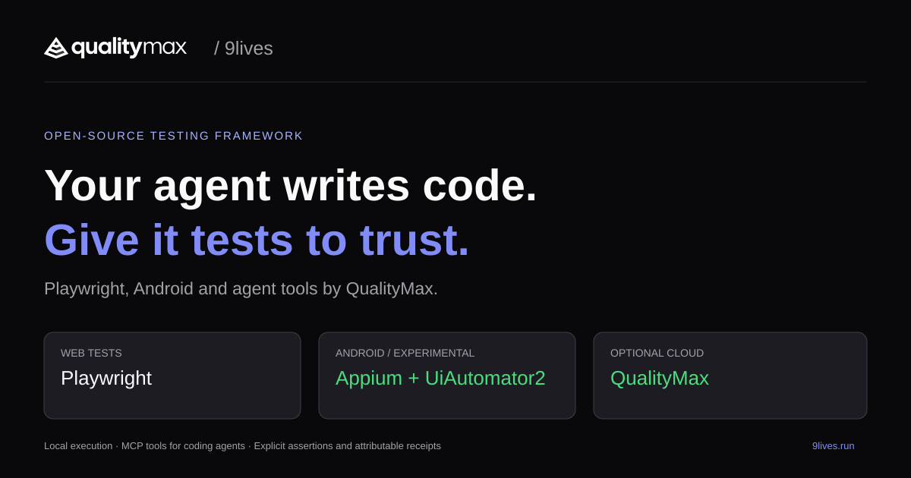

# 9lives by QualityMax

[](https://www.npmjs.com/package/@9l/playwright)
[](https://github.com/Quality-Max/9lives-runner/actions/workflows/ci.yml)
[](LICENSE)

[](https://9lives.run)

9lives (`9l`) checks Playwright tests written by coding agents. It reviews a
spec before it runs (`9l assess`), runs it and writes a validated execution
receipt (`9l run`), and checks that a reproduction fails before a fix and
passes after it (`9l confirm`). Coding agents get the same tools from
`9l mcp`. It runs your existing Playwright project locally, with no account.


A failing test that Playwright reports green, flagged by `9l assess` before
the run and by `9l run --sdk` after it. The recording is reproducible from
[demo/readme](demo/readme).

## Why not just `npx playwright test`?

Playwright's exit code reports Playwright's verdict. When an agent wrote the
test, that verdict can be wrong in ways you will not see:

- **A failing run can report green.** On Playwright 1.61.1 through 1.65.1,
  `test.fail()` in an after hook turns a failed test into an expected
  failure, so the summary says it passed and the process exits 0, and
  `test.skip()` in an after hook reports a test that ran and passed as
  skipped ([microsoft/playwright#43676](https://github.com/microsoft/playwright/issues/43676),
  [microsoft/playwright#43738](https://github.com/microsoft/playwright/issues/43738)).
  `9l assess` flags `test.fail()` in after hooks, and `9l run --sdk` counts
  `runtimeExpectedFailures` and `skippedAfterAssertions` in the receipt.
  Without `--sdk`, Playwright's JSON report cannot tell these apart.
- **Incomplete is never passed.** `9l run` exits 0 only when every planned
  job has a validated passing receipt. Cancellation, timeouts, missing or
  invalid evidence, a filter that matches no test, or an app that never
  answered `--wait-for` exit 3 (`incomplete`).
- **Weak passes are labelled.** Receipts count tests that passed only on a
  Playwright retry and, with `--sdk`, tests that passed without reporting an
  assertion step.
- **Failures are classified** as `assertion`, `timeout`, `action-timeout` or
  `environment`, so a server that never came up is not read as a broken test.
- **The test itself is reviewed.** `9l assess` flags fixed sleeps, "nothing
  happened" checks after a sleep, unawaited and swallowed assertions and
  conditional skips, and maps assertions to a requirements contract.

9lives does not write tests. A pass means the assertions passed and the
report was validated; it does not prove the assertions cover the requirement.

## Install and run

```sh
curl -fsSL https://9lives.run/install.sh | sh
export PATH="$HOME/.local/share/9lives-runner/bin:$PATH"
9l doctor
9l assess 'tests/**/*.spec.ts'
9l run tests/checkout.spec.ts --timeout 2m --attempts 1
```

Run from your project root with your own specs. Your project supplies
Playwright, browsers and configuration; the optional SDK is
[`@9l/playwright`](packages/playwright/README.md). Windows ZIPs, `go install`
and `9l update` are in the [install guide](docs/install.md); prerequisites and
troubleshooting are in the [quickstart](docs/run-existing-project.md).

## Check that a test tells broken from fixed (experimental)

```sh
9l confirm tests/repro/order-count.spec.ts --unfixed HEAD
```

`confirm` runs the reproduction on each Git revision in its own checkout and
reports `confirmed`, `not-reproduced`, `fix-ineffective`, `regressed` or
`inconclusive`. It is qualified on one synthetic repository in Chromium. See
[confirm](docs/confirm.md), and [prove](docs/prove.md) for fault injection.

## Give it to your coding agent

```sh
claude mcp add 9lives -- 9l mcp
```

`9l mcp` serves execution, assessment, confirmation, healing, page
inspection and reproduction tools over MCP stdio. See the
[MCP server](docs/mcp.md) and [agent setup](docs/agent-setup.md) for Codex,
Claude and the optional [QA skill](skills/9lives-qa/SKILL.md).

Prompts that hold the agent to evidence:

```text
Use the 9lives MCP tools to write a Playwright test for {behavior} from
{acceptance criteria}. Build locators from inspect_page {url}, map every
criterion to an expect() assertion, resolve every assess_test concern, then
run_test it. Report the status, receipt path and any criterion left unchecked.
It is not done unless run_test returned passed.
```

```text
{spec} is failing. run_test it and show me the failure class. If an assertion
failed, stop and show me expected versus actual; do not change the assertion.
If a locator broke, run heal_test without apply and show me the diff. Do not
add retries, waits or skips.
```

More for reviews, bug-fix confirmation and finding triage are in
[agent prompts](docs/agent-prompts.md).

## Evidence

An [independent field report](docs/reviews/field-report-2026-10-09.md) on CLI
0.1.0 ran `9l assess` over 87 spec files (760 tests) in 2.7 s, and tests
written through the assess-and-run loop failed on 3 of 3 planted defects. The
same report found false positives (fixed in 0.1.1), did not yet recommend
`assess` as a CI gate, and found little extra value in `9l run` where CI
already keeps reports and traces. The [interactive demo](https://9lives.run/demo.html#proof)
shows recorded before/after receipts on one synthetic app.

## Also included

- Optional SDK steps and bounded goals: [SDK bridge](docs/sdk-bridge.md), [goals](docs/goals.md)
- Locator healing verified in isolation: [Tier 1](docs/native-tier1.md), [Tier 2](docs/native-tier2.md)
- Page checks, `9l scan` and `9l inspect`: [page checks](docs/scan.md)
- Engine-observed HTTP postconditions, experimental `9l run --verify`: [verify](docs/verify.md)
- Android (experimental): [Android driver](docs/android-driver.md); iOS Simulator (experimental): [iOS driver](docs/ios-driver.md)
- Hosted sessions in QualityMax Cloud: [integration contract](docs/qualitymax-coding-sessions.md)
- What is shipped, experimental and planned: [documentation index](docs/README.md#what-is-available)

## Compatibility

| Component | Qualified |
| --- | --- |
| CLI and `@9l/playwright` | 0.8.0, released together; install matching versions |
| `@playwright/test` | 1.61.1 through 1.65.1 with 0.8.0 |
| Browser | Chromium; other engines are unqualified |
| Node | 24 (22 minimum) |
| Platforms | macOS, Linux and Windows on amd64 and arm64 |

The full matrix, the native targets and the SDK handshake are in
[compatibility](docs/compatibility.md).

## More

[Documentation](docs/README.md) · [CLI reference](docs/cli.md) ·
[JSON contract](docs/contracts.md) · [Architecture](docs/architecture.md) ·
[Changelog](CHANGELOG.md) · [Contributing](CONTRIBUTING.md) ·
[Discussions](https://github.com/Quality-Max/9lives-runner/discussions) ·
[Support](SUPPORT.md) · [Security](SECURITY.md)

If 9lives caught a test that should have failed, a star helps other teams
find it: star the repository on GitHub, or run `9l star --gh` with the
GitHub CLI.

Apache-2.0. See [LICENSE](LICENSE) and [NOTICE](NOTICE). Third-party
components retain their own licenses and notices.
