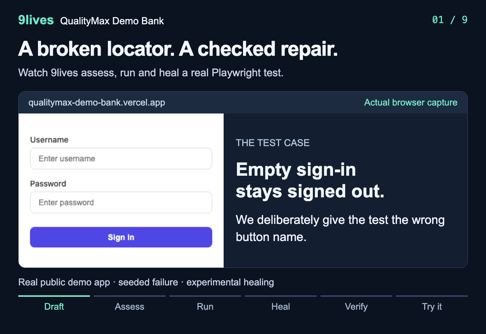
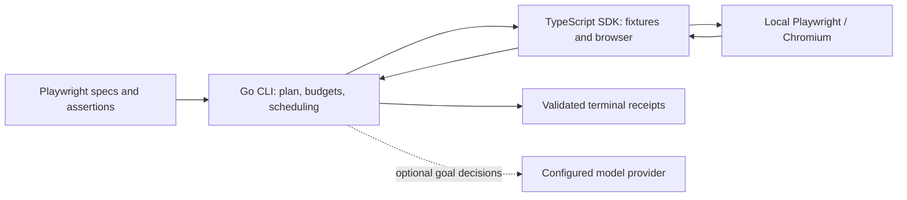

# 9lives runner

[](https://www.npmjs.com/package/@9l/playwright)
[](https://www.npmjs.com/package/@9l/playwright)
[](https://github.com/Quality-Max/9lives-runner/actions/workflows/ci.yml)
[](LICENSE)

Run Playwright tests with bounded execution and attributable receipts. Add
named steps and natural-language goals while keeping explicit assertions as
the test oracle. Local execution needs no QualityMax account or hosted service.

9lives runs, assesses, and stress-tests Playwright tests locally;
[qmax-code](https://github.com/Quality-Max/qmax-code) is the terminal coding and
QA agent that drives broader repository workflows.

[Documentation](docs/README.md) · [Explainer](https://quality-max.github.io/9lives-runner/) ·
[Local demo](demo/README.md) ·
[npm SDK](https://www.npmjs.com/package/@9l/playwright) ·
[CLI releases](https://github.com/Quality-Max/9lives-runner/releases)

## Watch it repair a Demo Bank test

A deliberately stale button name breaks a Playwright test against the public
[QualityMax Demo Bank](https://qualitymax-demo-bank.vercel.app/). Follow the draft
through assessment, failure, offline repair and a passing candidate.



The GIF is a 68.5-second edited replay of real browser captures and checked CLI
results, with large text and one step per frame. Experimental healing changed
one locator literal, preserved every assertion and verified one passing test.
The candidate was saved for review; the original file was not changed.

[Run this example](demo/README.md#qualitymax-demo-bank) ·
[Still image](demo/demo-bank.png) ·
[Checked results](demo/demo-bank-evidence.json)

## Main features

- **Agent-assisted test generation:** your coding agent creates Playwright specs using the optional [QA skill](skills/9lives-qa/SKILL.md). Record creation provenance, assess the draft and execute it; there is no native `9l generate` command.
- **Assessment:** `9l assess` reviews waits, skips, missing or unawaited assertions, and requirement mappings. Findings are advisory.
- **Execution:** `plan`, `run`, `status`, `result` and `cancel` bound execution and retain attributable terminal receipts.
- **Healing:** experimental native `9l heal` preserves assertions and verifies supported locator-only candidates in isolation before acceptance.
- **Fault testing and confirmation:** experimental `prove` injects fetch/XHR faults; `confirm` compares a reproduction on unfixed and fixed Git revisions. Their results have [documented limits](docs/README.md).
- **Page checks:** `9l scan` reports console, link, accessibility, Core Web Vitals, SEO, security-header, cookie, mixed-content and page-weight findings from one Chromium page load, with baseline comparison; `9l inspect` ranks a page's locators. Both are observations, not test results.
- **Agent integration and SDK:** native `9l mcp` provides execution, assessment, healing, confirmation, page scan, page inspection and reproduction tools; the optional SDK adds named steps and bounded goals. Goal completion is unverified.
- **Cross-platform:** native Linux, macOS and Windows binaries on x64 and ARM64. Windows provider CLI shell integrations remain unqualified.

Built by QualityMax without any external funding. Keep your suite. Inspect the evidence.

For the separate SDK checkout fixture and its original terminal recording,
see the [local checkout demo](demo/README.md#local-checkout-demo).

## Start with an executed result

Install the published SDK in your Playwright project:

```sh
npm install --save-dev @9l/playwright@0.4.0 @playwright/test@1.64.0
npm exec playwright install chromium
```

Use Node 24 for the qualified runtime (Node 22 minimum) and Playwright 1.61.1
through 1.64.0; an existing project can keep its version in that range. On Linux, use
`npm exec playwright install --with-deps chromium` for browser dependencies.

Install the Go CLI separately. With Go 1.25.13 or newer:

```sh
go install github.com/Quality-Max/9lives-runner/cmd/9l@latest
9l --version
```

Ensure Go's binary directory is on your `PATH`. Prebuilt CLI releases target
macOS, Linux and Windows on amd64 and arm64, so their users do not need Go. See
the [download and checksum instructions](docs/install.md) for availability and
platform selection. Windows ZIPs start with v0.2.0; earlier releases have
macOS/Linux assets only.
The npm package supplies the fixtures; it does not install
the CLI or browsers.

### Run a test

Keep your application's existing Playwright configuration and reviewed
assertions. For an application serving a checkout page:

```ts
import {test, expect} from '@9l/playwright';

test('checkout confirms an order', async ({page, n9l}) => {
  await page.goto('http://localhost:3000/checkout');
  await n9l.step('place the order', async () => {
    await page.getByRole('button', {name: 'Place order'}).click();
    await expect(page.getByRole('status')).toHaveText('Order confirmed');
  });
});
```

Start the application, then run from the test project:

```sh
9l run tests/checkout.spec.ts --sdk --format json
```

For a complete runnable example that needs no application server or model,
clone this repository and follow the [local checkout demo](demo/README.md).
For an existing application, see the [integration guide](docs/run-existing-project.md).

### What the result establishes

The runner records a terminal outcome for every required test and validates
SDK evidence against the owning run, job and attempt. Required failures,
missing evidence, unexplained skips and interruption prevent an overall green
result. Receipts persist under `.9lives/receipts/`; inspect them with
`9l result <run-id> --format json`.

A passing execution means the test's assertions passed and its report was
validated. It does not prove that the assertions fully cover the requirements.
Independent behavioral verification remains planned.

### Check the page you changed

Before a coding agent calls a web change done, give it evidence from the page
itself. `9l scan` loads the page once in Chromium with the project's own
Playwright and reports graded findings with reproduction steps and suggested
fixes:

```sh
9l scan https://your-app.dev --format markdown
9l scan http://localhost:3000/ --allow-private-network --format json --out scan.json
9l scan http://localhost:3000/ --allow-private-network --baseline scan.json --fail-on-new
9l inspect http://localhost:3000/login --allow-private-network
```

| Check | What it reports |
| --- | --- |
| `console` | JavaScript errors, warnings and failed requests |
| `links` | Broken and redirecting links, up to `--max-links` |
| `accessibility` | Missing alt text, unlabelled controls, nameless interactive elements, heading structure |
| `performance` | Core Web Vitals LCP and CLS, plus TTFB and FCP load timings (INP, the third Core Web Vital, needs real interaction and is not measured) |
| `seo` | Title and meta description |
| `security_headers` | CSP, HSTS, `X-Content-Type-Options`, `Referrer-Policy` |
| `cookies` | Missing `Secure`/`HttpOnly`/`SameSite`, third-party cookies, known trackers, tracking before consent |
| `mixed_content` | HTTP subresources and form actions on an HTTPS page |
| `weight` | Transfer bytes, request count, render-blocking resources, oversized and uncompressed assets |

The Markdown report opens with the grade and the categories to fix first:

> **Grade: 🔴 F  (0 / 100)**   ·   15 issues found
>
> | Category | Issues | Worst |
> |----------|--------|:-----:|
> | Console errors | `██████████` 4 | 🔴 high |
> | Accessibility | `████████░░` 3 | 🔴 high |
> | Security headers | `██████████` 4 | 🟠 medium |

`--baseline` compares against an earlier JSON result and reports new, fixed
and unchanged findings, so a pipeline can fail only on regressions.
`9l inspect` returns the page's ranked locators (test id, role and label
before text and position), each control's stability and a testability
verdict. A page behind a login is checked with a Playwright storage-state
file and `--acknowledge-private-content`. Loopback targets need
`--allow-private-network`; other private addresses stay blocked. Scans are
observations from one cold page load, not test results.

Coding agents get the same checks from `9l mcp` as `scan_url` and
`inspect_page`, plus `generate_playwright_repro`, which writes a spec for a
finding that `run_test` executes and `confirm_finding` checks across a fix.
These checks were previously the separate qmax-mcp npm server.

## What you can do

| Capability | Available behavior | Boundary |
| --- | --- | --- |
| Plan and run | Discover specs, inspect plans, bound concurrency and deadlines | Runs locally installed Playwright; no automatic tooling downloads |
| Inspect and cancel | `status`, `result`, `cancel`, and terminal receipts | Interrupted runs are classified; automatic crash recovery is planned |
| SDK steps | `n9l.step(...)` with normal browser fixtures and assertions | Opt in with `--sdk`; existing execution stays available separately |
| Visual mode | `run --headed` shows the browser, one job at a time by default | Linux needs a display (`xvfb-run -a` on headless machines); slow motion comes from the project's `launchOptions` |
| Bounded goals | `n9l.goal(...)` over finite observed controls | Completion is unverified; live model accuracy and cost are unqualified |
| Test assessment | `assess` and source/branch provenance | Advisory static review; it does not establish executed assertion coverage |
| Fault proof | Experimental `prove`: re-run a spec once per injected fetch/XHR fault and report which an assertion caught | Needs `@9l/playwright` 0.1.1 (0.1.3 for the `--faults` opt-in kinds); a caught fault shows an assertion failed, not that it checks the right thing |
| Finding confirmation | Experimental `confirm`: run a reproduction spec on the unfixed and fixed Git revisions, each in its own checkout, and report confirmed, not-reproduced, fix-ineffective or regressed | Code under test must be started or imported from the checkout; confirmed shows the spec tells the revisions apart, not that it tests the finding |
| Healing | Offline Tier 1 proposals and experimental native Tier 2 verification | Preserve assertions; verify candidates in isolation before application |
| Page checks | `scan`: nine checks from one Chromium page load, baselines and `--fail-on-new`; `inspect`: ranked locators and testability | Observations, not test results; one cold load, not field data; loopback needs explicit consent |
| Reproductions | MCP `generate_playwright_repro` writes a deterministic spec for a finding, URL or goal | Runs nothing; review it, then `run_test` or `confirm_finding` |

See the [CLI reference](docs/cli.md), [assessment guide](docs/test-assessment.md), [prove](docs/prove.md), [confirm](docs/confirm.md),
[native Tier 1](docs/native-tier1.md) and [native Tier 2](docs/native-tier2.md).
Verified replay and native mobile qualification remain subsequent milestones.
Windows process ownership uses kill-on-close Job Objects; native Windows
amd64 and arm64 CI checks Chromium execution and process-tree cleanup.
Provider CLI shell integrations on Windows remain unqualified.

### Add a bounded goal

```ts
await n9l.goal('Fill Name using name, then click Continue.', {
  params: {name: 'Fixture Person'}, maxActions: 3, timeoutMs: 30_000,
});
await expect(page.getByRole('heading', {name: 'Review'})).toBeVisible();
```

Choose `--goal-provider anthropic` or `openai` and configure its credential
securely in Go's calling environment, or `claude`, `codex` or `opencode` to
use that CLI's own subscription login without an API key. Offline `--goal-script` fixtures exercise
the browser/engine contract without paid API calls. Purchase, deletion and
outreach controls stop by default. See [goal contracts](docs/goals.md).

## Compatibility

| Component | Qualified | Boundary |
| --- | --- | --- |
| `@playwright/test` | 1.61.1, 1.62.0, 1.62.1, 1.63.0, 1.64.0 | CI runs the unit, browser, assessment and packed-SDK checks on each. Later 1.x releases install (peer range `>=1.61.1 <2`) but are unqualified |
| `9l assess` matchers | Playwright 1.61.1 through 1.64.0 | The async matchers are identical across that range. A matcher outside it is reported as an `unknown-matcher` limit, not guessed |
| Browser | Chromium | Other engines are unqualified |
| Node | 24 (22 minimum) | |
| CLI | 0.4.0 on macOS, Linux and Windows, amd64 and arm64 | Provider CLI shell integrations on Windows are unqualified |
| SDK | `@9l/playwright` 0.4.0, released with the CLI | Installing the SDK does not install the CLI or browsers |

Keep your project's existing Playwright version if it is in the qualified
range; upgrading is not required. To check a release locally, see the
[development guide](docs/development.md).

## Add it to your coding agent

The optional [9lives QA skill](skills/9lives-qa/SKILL.md) guides Codex and Claude
through requirements, source provenance, assessment and executed results.
Use the [agent setup guide](docs/agent-setup.md) to add it to a project.

## Adjacent QualityMax tools

| Tool | Use it for |
| --- | --- |
| [qmax-mcp](https://github.com/Quality-Max/qmax-mcp) | The earlier standalone npm server for scans and inspection; its checks now ship in `9l scan`, `9l inspect` and `9l mcp`, and its hosted-account proxy is not included |
| [9lives Python](https://github.com/Quality-Max/9lives) | Python-only healing options, Cypress/Selenium adapters and watch/report commands |
| [qualitymax-grader](https://github.com/Quality-Max/qualitymax-grader) | An offline A–F hygiene grade for a spec before it is committed, run by the QA skill alongside `9l assess`; the grade is not a 9lives result or coverage evidence |

These are separate distributions. Installing this runner or SDK does not
install or configure them. The Python package also provides a `9l` command;
use an explicit executable path when both CLIs are installed.

## Safety and honest limits

Test code executes with the local user's permissions. Use approved targets
and explicitly pass required application environment keys with `--pass-env`.
Goal parameter values stay in the browser worker; provider credentials stay
in Go. Receipts omit page content and attachment bodies by default, and bound
and sanitize diagnostics. Review the [SDK evidence contract](docs/sdk-bridge.md)
for identity, privacy, skip pins and failure handling.

## Architecture



Go owns execution identity, cancellation and completeness. TypeScript owns
browser handles and fixtures. The bounded `9l.engine/1` protocol joins them.
See [architecture decisions](docs/architecture.md) and the
[performance baseline](benchmarks/BASELINE.md), which separates runner overhead
from Playwright and browser costs.

## Support and responsible disclosure

Use [GitHub Issues](https://github.com/Quality-Max/9lives-runner/issues) for
non-sensitive usage and documentation questions. Report vulnerabilities
privately using the [security policy](SECURITY.md).

## Development

```sh
npm ci
npm exec playwright install chromium
npm run demo
go test -race ./...
go vet ./...
```

The [development guide](docs/development.md) lists SDK qualification, pinned
Python compatibility checks and repository boundaries.
See [contributing](CONTRIBUTING.md) before proposing changes.

## Package and release metadata

The published [@9l/playwright 0.4.0](https://www.npmjs.com/package/@9l/playwright)
and the Go CLI are separate distributions with one shared version: a single
`v<version>` tag releases both. Binary archives include `LICENSE`, `NOTICE` and
release-wide SHA-256 checksums. See the [release runbook](docs/releases.md)
and [changelog](CHANGELOG.md).

## License

[Apache-2.0](LICENSE). Third-party components retain their own licenses and
notices. The SDK package and CLI archives include `LICENSE` and `NOTICE`.
